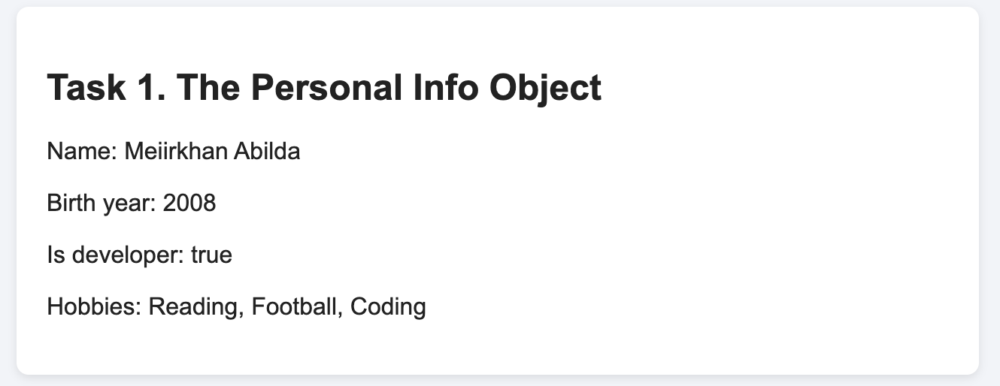
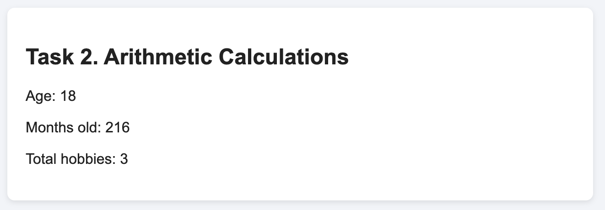
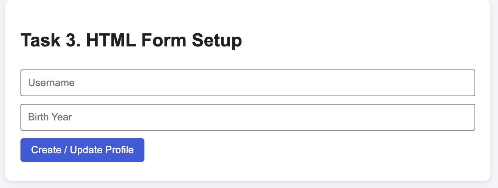
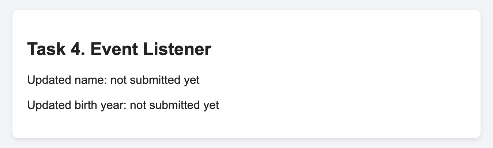
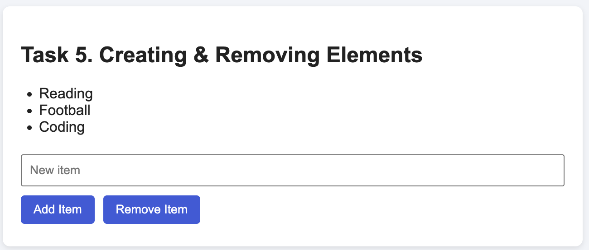

# Assignment 5 - JavaScript Basics

Meiirkhan Abilda, IT-2503

Live page: https://meirhan35.github.io/webassignment5/

Everything is in one file, index.html. Open it and the five tasks are on the page one under another, each in its own box, so it is easy to scroll and show them in order.

## Task 1. The Personal Info Object

Make a const object called userProfile with a string (name), a number (birthYear), a boolean (isDeveloper) and an array (hobbies).

I used const because the object itself never gets replaced, I only change the values inside it. The page prints all four values so you can see each data type.

## Task 2. Arithmetic Calculations

Calculate the current age with arithmetic operators and one more metric, then show it in the console or on the page.

Age is the current year minus the birth year, and I take the current year from new Date().getFullYear() so it never gets old. Then months old is age times 12, and the hobbies count is just the length of the array. All three show on the page and in the console.

## Task 3. HTML Form Setup

Make a form with a Username input, a Birth Year input and a "Create / Update Profile" button.

Nothing special here, two inputs and one submit button inside a <form>.

## Task 4. Event Listener

Add a click or submit listener to the button, take what the user typed and update userProfile.

I listen for submit on the form, not click on the button, because then pressing Enter works too. I call event.preventDefault() first, otherwise the browser reloads the page and everything is lost. If a field is left empty, the old value stays. After the update, the new name and birth year show in the Task 4 box and Tasks 1 and 2 refresh with the new numbers.

## Task 5. Creating & Removing Elements

Make a "<ul>" of tasks or hobbies, an "Add Item" button that adds a new <li> from user input, and a "Remove Item" button that deletes the last one.

The list is drawn from the hobbies array. Add creates an <li> with createElement, pushes the text into the array and redraws the list. Remove uses pop() to take off the last item. Because the list and the array are the same thing, the hobbies count in Task 2 changes together with the list. Empty input is ignored.

## How I worked

I did it in the same order as the tasks. First the object and the numbers, checking in the console that they were right. Then the form, and only after that I connected it to the object. I left the list for last because it needed the array to already work. At the end I made sure that changing something in one task updates the others, so the page always shows the same data everywhere.
